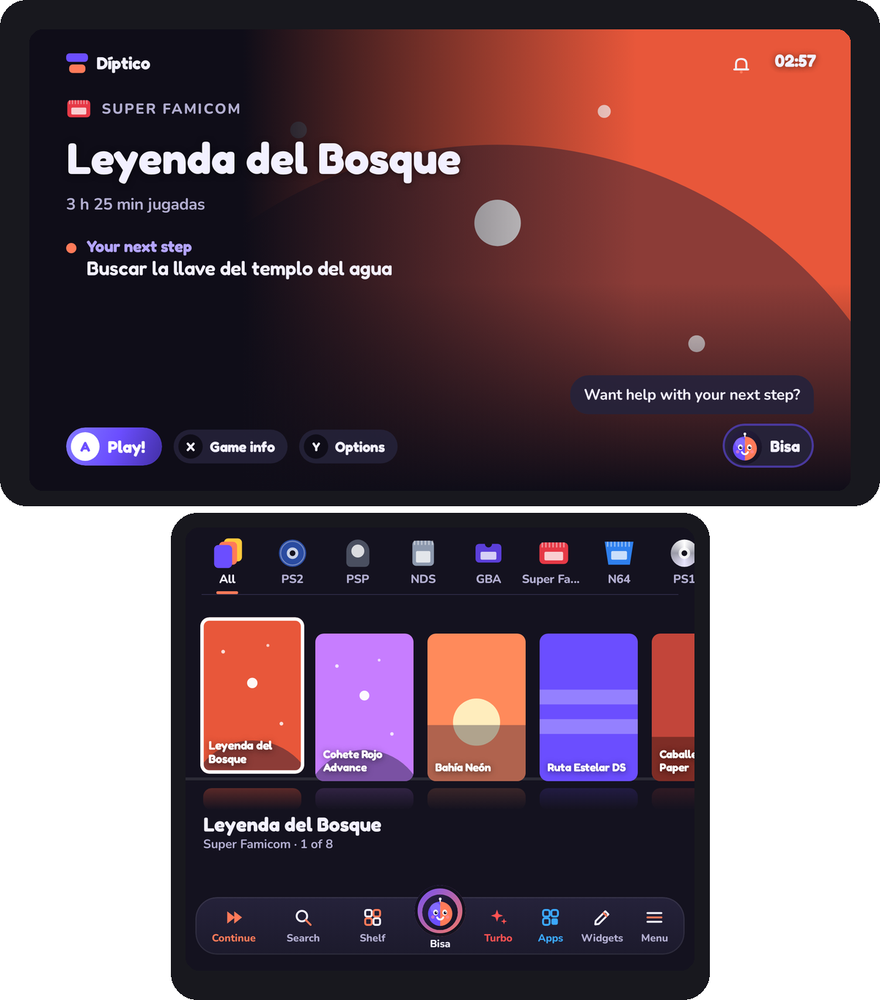
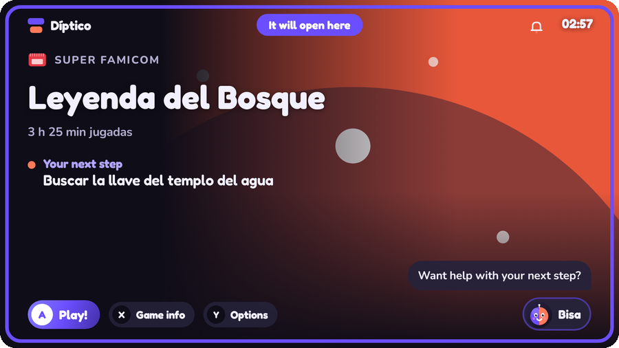
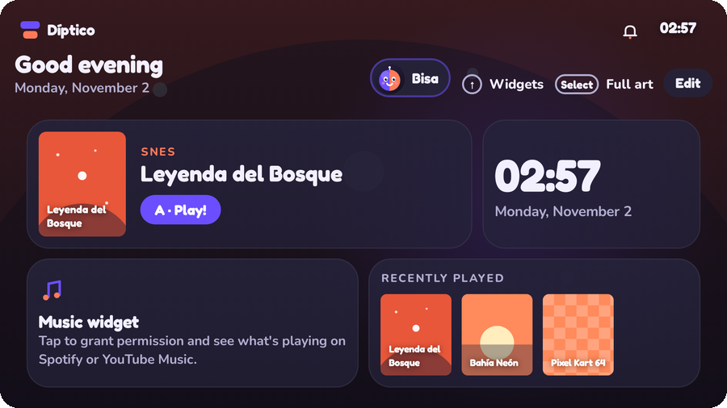
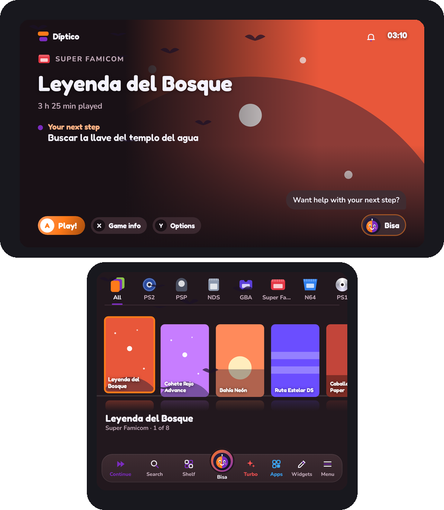

# Díptico

**Launcher de juegos para Android, con una o dos pantallas.**

En una consola de dos pantallas, el arte del juego se luce arriba y la biblioteca se recorre abajo. En una pantalla, la biblioteca, el inicio y los ajustes comparten la misma interfaz.

[Descargar la beta](https://github.com/nikalbazu24/Diptico-frontend/releases) · [Participar en la beta](https://github.com/nikalbazu24/Diptico-frontend/issues/new?template=2-tester.yml) · [Reportar un problema](https://github.com/nikalbazu24/Diptico-frontend/issues/new?template=1-bug.yml) · [English](README.md)

Ver capturas de ejemplo

## Instalar y actualizar

1. Abre [Releases](https://github.com/nikalbazu24/Diptico-frontend/releases) en tu dispositivo con **Android 10 o superior y arquitectura ARM64**.
2. En la beta pública `v1.1-beta.N`, descarga `Diptico-v1.1-beta.N.apk` para consolas o `Diptico-v1.1-beta.N-movil.apk` para teléfonos. La variante móvil omite el acceso a notificaciones y los widgets que dependen de ese permiso.
3. Abre el APK y sigue el tutorial para elegir el modo de pantallas, agregar tus carpetas y conectar los emuladores. Puedes establecer Díptico como pantalla de inicio de Android.
4. Las betas con la misma firma se instalan encima. Díptico busca su variante y permite actualizarla desde **Menú › Acerca de**. Al volver a abrirlo, el tour reúne las novedades que te saltaste. Si vienes de una beta con otra firma, consulta la [guía de migración](docs/distribucion.md).

Necesitas tus propios archivos de juego y BIOS y los emuladores correspondientes.

## Pantallas y controles

- **Dos pantallas**. Arte grande, logo, ficha o vista previa arriba, biblioteca o widgets abajo. Mantén Select para intercambiar las pantallas. Puedes elegir dónde abre cada juego o app, recordar la elección y fijar una ficha en la otra pantalla.
- **Una pantalla**. Biblioteca, carpetas, widgets, barra táctil, teclado, galerías y tienda de temas en la pantalla principal. Las galerías permiten revisar y aplicar los cambios ahí mismo. Los ajustes también tienen vista previa.
- **Equipos y televisor**. Perfiles para AYN Thor, Odin, Retroid, Anbernic, AYANEO, teléfonos, tablets y teles. Escala y letra configurables. El modo sobremesa adapta márgenes, tamaño, audio y efectos para la TV.
- **Navegación**. Mando o toque, atajos configurables para sticks y botones extra, teclado de Díptico con dictado, buscador de ajustes y vistas previas. El cajón de apps admite fijar, ordenar, abrir en una pantalla y desinstalar con confirmación de Android.
- **Centro de control**. Ajustes rápidos de conexión, brillo, volumen, Turbo y No molestar. En la variante completa, las notificaciones se abren por separado y se puede controlar la música de otras apps.

## Biblioteca de juegos

- **Fuentes de juegos**. Varias carpetas en la memoria interna o SD con nombres de consola de ES-DE. Puedes asignar una consola manualmente, conectar `downloaded_media` e importar títulos y favoritos desde `gamelist.xml` con revisión previa.
- **Emulación y juegos nativos**. Reglas de lanzamiento de ES-DE, selección de emulador o núcleo de RetroArch por consola o juego, detección de juegos Android, ports y accesos de PC. Puedes agregar títulos de Steam para lanzarlos con un cliente compatible instalado. Los fan games RPG Maker XP/VX/VX Ace se abren con [Essentia](https://github.com/Nikalbazu24/essentia) desde `rpgmaker`, `fangames` o un acceso `.essentia`.
- **Vistas de consolas**. Pestañas arriba, columna lateral, rueda, Sistemas, Carpetas y Discos. Puedes ordenar y personalizar cada consola con nombre, color, arte, logo, música y forma de las cajas.
- **Carpetas como íconos**. Pellizca la cuadrícula para cambiar el tamaño y elige recorrido horizontal o vertical. Abre sus juegos en una ventana con la cuadrícula desenfocada detrás o a pantalla completa. Con **X** o manteniendo el ícono, puedes buscar arte de la consola o de un juego en los proveedores disponibles o elegir un archivo. En vistas como Carpetas, Mosaico y Vitrina, **Juego elegido** va mostrando títulos de la carpeta bajo el cursor.
- **Vistas de juegos**. Estante, cuadrícula, lista, carrusel 3D, abanico y lomos. Ajusta el tamaño y la forma de las cajas y elige si muestran portada, captura o logo. Puedes agrupar variantes y elegir un disco cuando el juego trae una lista compatible.
- **Organización**. Búsqueda sin importar tildes, favoritos, recientes, más jugados, sin jugar, orden manual, filtros y colecciones propias. Para recuperar la vista anterior después de buscar juegos ocultos, toca **Salir de Ocultos** o pulsa **B**.
- **Arte y fichas**. Descarga o elige portadas, arte grande y logos. Encuadra las imágenes, edita el título, asigna música y consulta historia, guías, notas y logros de RetroAchievements. La desinstalación de juegos administrados por Díptico muestra qué archivos se quitarán antes de confirmar.

### Carpetas y emuladores

| Carpeta | Sistema | Ejemplos de emuladores |
|---|---|---|
| `snes`, `gba`, `n64` | Super Nintendo, Game Boy Advance, Nintendo 64 | Snes9x EX+, Pizza Boy GBA, Mupen64Plus FZ, RetroArch |
| `psx`, `ps2`, `psp` | PlayStation, PlayStation 2, PSP | DuckStation, NetherSX2, PPSSPP, RetroArch |
| `gc`, `wiiu` | GameCube, Wii U | Dolphin, Cemu |
| `nds`, `n3ds` | Nintendo DS, Nintendo 3DS | melonDS, DraStic, Azahar, Citra |
| `switch`, `psvita` | Nintendo Switch, PS Vita | Eden, Kenji-NX, Skyline, Vita3K |

En **Menú › Emuladores**, elige una opción instalada. En RetroArch, descarga primero el núcleo correspondiente. Para PS3 se admiten, según el emulador, imágenes `.iso`, juegos en carpeta o un archivo `.ps3` con su código para ARMSX3. Para PS4, importa el juego en Bachata S4 y crea un archivo `.ps4` con su código, por ejemplo `CUSA00900`. Las reglas completas están en [el catálogo de sistemas](app/src/main/assets/sistemas.json).

### Fuentes de imágenes

Díptico lee imágenes locales con el nombre del juego, junto a sus archivos o en carpetas como `covers`. Con ES-DE puede leer `covers`, `fanart` o `screenshots`. Para descargar lo que falta o elegir imagen por imagen, abre **Menú › Portadas**. El tipo de arte disponible depende de la fuente y del sistema.

| Fuente | Acceso |
|---|---|
| libretro-thumbnails, paquetes de RetroArch y Wikipedia | Sin clave |
| SteamGridDB | Clave API de tu cuenta |
| ScreenScraper | Usuario y contraseña, más ID y contraseña de desarrollador |
| IGDB | Client ID y Client Secret de Twitch |
| TheGamesDB y RAWG | Clave API del proveedor |

## Inicio y personalización

- **Widgets**. Páginas y grilla ajustable con pellizco, movimiento y redimensionado por toque o mando. El estudio cambia tamaño, fondo, forma, diseño, color y contenido. Incluye juego elegido, reloj, batería, música, notificaciones, favoritos, recientes, estadísticas, logros, calendario, temporizador, cronómetro, búsqueda, Bisa, cola de juegos, ideas para partidas cortas, colecciones, accesos, imágenes, GIF y videos cortos.
- **Tienda integrada**. En **Menú › Temas › Tienda de temas**, explora, previsualiza e instala **30 temas incluidos** sin conexión. En dos pantallas se abre arriba. Incluye diseños inspirados en Mario, Pokémon, Zelda, Metroid, Kirby y Sonic con paletas, formas, fondos, música, efectos y adornos propios.
- **Calendario mundial y chileno**. Los temas pueden cambiar solos en fechas como Año Nuevo Lunar, Halloween, Día de Muertos, Fiestas Patrias, Navidad, Glorias Navales y La Tirana. En **Menú › Decoraciones**, despliega un tema para elegir su adorno e intensidad cuando corresponda. Por ejemplo, muérdago o campanas en Navidad y chupallas o volantines para Chile.
- **Tu estilo**. Modo claro, oscuro u OLED, colores propios, música incluida o de tu carpeta, efectos de sonido y formas de botones. **Mezclar mi tema** combina colores, fondo, tipografía, formas, decoración, efectos y música de temas instalados. **Universo del juego** usa colores de su arte local. Las colecciones también pueden tener color, fondo, logo, música y disposición propios.
- **Temas y perfiles compartibles**. Importa temas en JSON o por enlace, crea un tema con IA y guarda perfiles de diseño para exportarlos e importarlos. Los aportes externos se crean en el [Estudio de temas](https://diptico-temas.nickalbazu.chatgpt.site). El [instructivo de la comunidad](docs/temas-comunidad.md) explica el formato y cómo probarlo dentro de Díptico.

## Durante y después de jugar

- **Bitácora y estadísticas**. Registra sesiones y tiempo de juego, guarda el próximo paso con texto, nota de voz o un pin en el mapa y recupera ese contexto al volver. Programa recordatorios de pausa y arma una cola para tus próximas sesiones.
- **Compañero de partida**. En la pantalla libre muestra hora, batería, tiempo de sesión, logo, controles y acceso a Bisa. La Lupa puede ampliar una zona de la otra pantalla y el clip opcional de retoma guarda hasta seis segundos sin audio. Ambas funciones necesitan permiso de captura de Android y la Lupa tiene prioridad. [Guía de retoma](docs/navegacion-retoma.md)
- **RetroAchievements y partidas**. Conecta tu cuenta y Web API Key para ver logros por juego y estadísticas. Puedes guardar hasta tres copias manuales de un archivo `.srm` de RetroArch y exportarlas para recuperarlas.
- **Bisa**. Sugiere juegos de tu biblioteca, da pistas por niveles, ofrece accesos y puede consultar la web si lo habilitas. Habla o escribe, usa el modelo local opcional sin conexión o conecta tu clave de Gemini u OpenAI. La burbuja durante un juego requiere el permiso de superposición.
- **Rendimiento y reposo**. Modos de fluidez, incluido Ahorro, Turbo, atenuación al jugar y protector de pantalla con tu biblioteca. Díptico puede mostrar una bienvenida y un acceso al último juego al volver al equipo.

## Ajustes, respaldo y ayuda

- **Respaldo**. En **Menú › Acerca de**, guarda o recupera ajustes, colecciones, tiempos y notas de texto o voz mediante un archivo local o Google Drive. Cuando eliges un destino para el respaldo diario, Díptico lo actualiza automáticamente. Las credenciales y permisos de carpetas se configuran de nuevo en cada equipo.
- **Idiomas**. Español, inglés, portugués, chino simplificado y japonés.
- **Beta abierta**. Puedes enviar un diagnóstico tras revisar su contenido o reportar un problema en GitHub. Indica el equipo, la versión, el modo de pantalla y los pasos para reproducirlo. [Formulario de errores](https://github.com/nikalbazu24/Diptico-frontend/issues/new?template=1-bug.yml)

### Atajos predeterminados

| Control | Acción |
|---|---|
| Cruceta o stick, L1 / R1 | Recorrer juegos y cambiar de consola |
| L2 / R2 | Saltar de letra |
| A, B | Entrar o jugar, volver o cerrar |
| Mantener A | Elegir dónde abrir un juego o app |
| X, Y | Ficha y opciones del juego |
| L3, R3 | Buscar y elegir vista |
| Select, mantener Select | Cambiar entre biblioteca y widgets, intercambiar pantallas |
| Start, mantener Start | Menú y centro de control |
| Start + R3 | Cajón de apps |

## Desarrollo y créditos

Díptico usa **Kotlin y Jetpack Compose**. GitHub Actions ejecuta pruebas, compila las variantes completa y móvil y genera capturas de interfaz. Los cambios de app en `main` publican la beta firmada. Consulta la [guía de distribución](docs/distribucion.md), las [notas de la beta](docs/novedades-beta.md) y el [historial de publicaciones](https://github.com/nikalbazu24/Diptico-frontend/releases).

- Reglas de lanzamiento y catálogo base de sistemas de [ES-DE](https://es-de.org) (MIT).
- Portadas de [libretro-thumbnails](https://github.com/libretro-thumbnails) e íconos de [retroarch-assets](https://github.com/libretro/retroarch-assets).
- Tiny5, fuente del tema Mundo de bloques, bajo SIL Open Font License 1.1.
- Historia de los juegos de Wikipedia.

Hecho en Chile por [@Nikalbazu24](https://github.com/Nikalbazu24).
