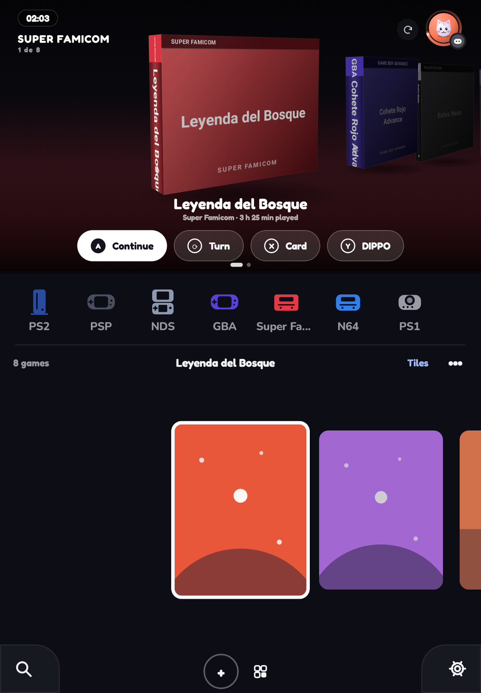
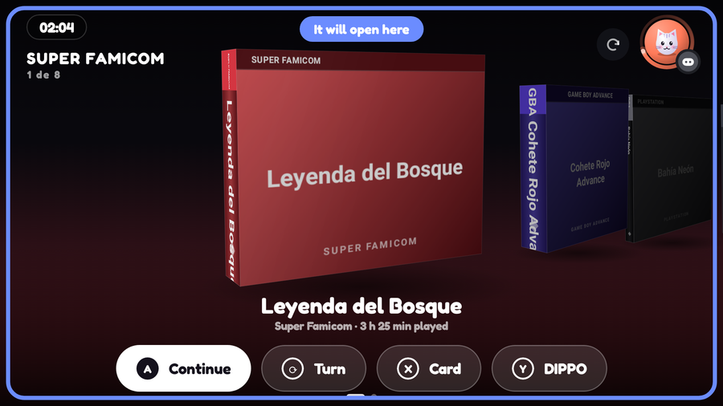
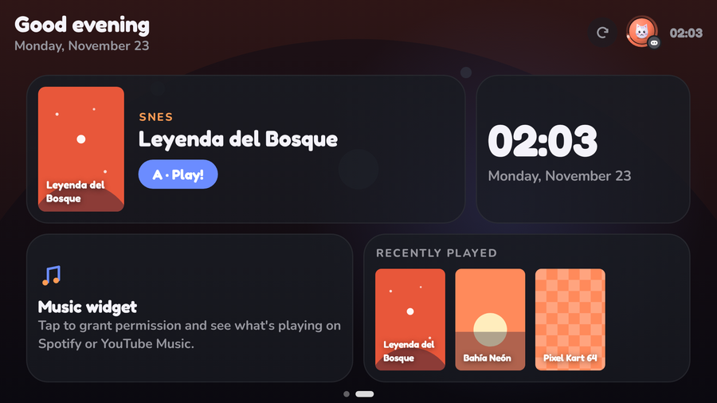
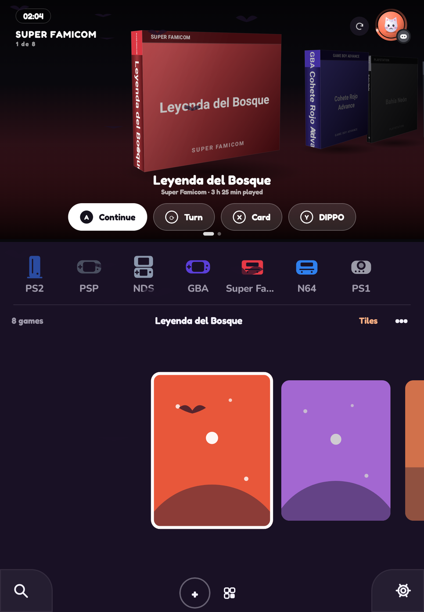
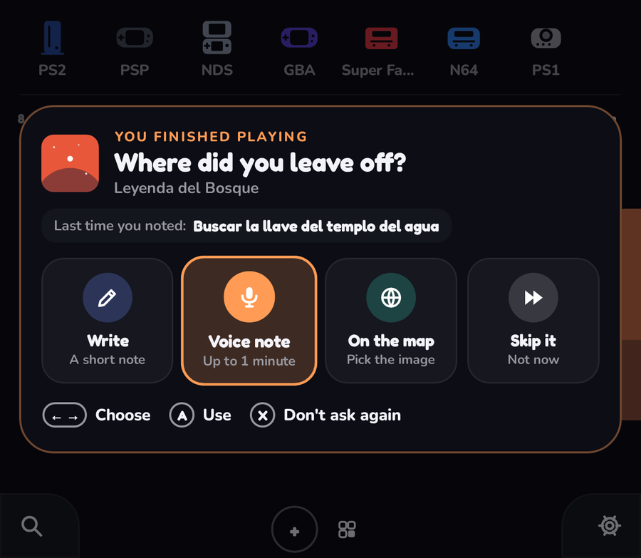

# Díptico

**Launcher de juegos para Android, con una o dos pantallas.**

En una consola de dos pantallas, el arte del juego se luce arriba y la biblioteca se recorre abajo. En una pantalla, la biblioteca, el inicio y los ajustes comparten la misma interfaz.

[Descargar beta](https://github.com/nikalbazu24/Diptico-frontend/releases) · [Participar en la beta](https://github.com/nikalbazu24/Diptico-frontend/issues/new?template=2-tester.yml) · [Reportar un problema](https://github.com/nikalbazu24/Diptico-frontend/issues/new?template=1-bug.yml)

Ver capturas de ejemplo

## Estado de la versión 2.0.0

La serie **2.0.0** incorpora la interfaz Colección viva, widgets más flexibles y un recorrido de bienvenida completo con DIPPO. La candidata `v2.0.0-rc.736` ya pasó su compilación y las pruebas automatizadas en GitHub Actions.

Antes de publicar la beta oficial conviene validar en consola real:

- mando y navegación con una y dos pantallas;
- actualización sobre una instalación beta anterior;
- apertura de emuladores y juegos en ambos perfiles;
- rendimiento al recorrer bibliotecas grandes;
- visualización de capturas, fondos y widgets.

## Instalar y actualizar

1. Abre [Releases](https://github.com/nikalbazu24/Diptico-frontend/releases) en un dispositivo Android 10 o superior con arquitectura ARM64.
2. Descarga `Diptico-v2.0.0-rc.N.apk` para consolas de una o dos pantallas, o `Diptico-v2.0.0-rc.N-movil.apk` para teléfonos.
3. Haz una copia de tus ajustes y partidas antes de cambiar de versión.
4. Abre el APK y completa el tutorial para elegir el modo de pantalla, agregar carpetas y conectar emuladores.
5. Puedes establecer Díptico como pantalla de inicio de Android.

La variante móvil omite algunos recursos exclusivos de consolas, como la distribución de notificaciones entre pantallas y ciertos widgets que dependen de ellas.

## Novedades de 2.0.0

- **Colección viva** con vitrinas, consolas, cajas 3D y fondos adaptados a cada colección.
- **Tu espacio** con páginas de widgets, edición por toque o mando y distribución configurable.
- **Dock inferior flotante** con contenido visible detrás y botones independientes.
- **Tour DIPPO interactivo** con retos reales, foco calculado sobre componentes visibles y soporte para una o dos pantallas.
- **Recorrido por pantalla o fondo de pantalla** para pantallas apagadas, con opciones actuales y nuevas.
- **Emulador por juego** desde la ficha de personalización, además de la selección global por consola.
- **Project Lemon** reconocido para juegos compatibles de Nintendo Switch 1, sin afectar otras plataformas.
- **Perfiles y perfiles visuales** compartibles, temas y fondos personales.
- **Transiciones más consistentes** entre biblioteca, carpetas, widgets y paneles.

## Pantallas y controles

- **Dos pantallas.** El arte ocupa arriba y la biblioteca, widgets o dock viven abajo. Mantén Select para intercambiar las pantallas.
- **Una pantalla.** Biblioteca, inicio, widgets, teclado y ajustes compartiendo el mismo lienzo.
- **Equipos y televisión.** Ajustes de escala, tipo de letra y distribución para AYN Thor, Odin, Retroid, Anbernic, AYANEO, teléfonos, tablets y TV.
- **Mando y tacto.** Cruceta, joysticks, botones extra, atajos configurables y navegación táctil.
- **Centro de control.** Conectividad, brillo, volumen, Turbo y No molestar. En la variante completa también muestra notificaciones y controles de música.

## Biblioteca de juegos

- Carátulas locales y buscadores compatibles con ES-DE.
- Carpetas de juegos con nombres de sistemas reconocidos.
- Emulador o núcleo de RetroArch por consola y por juego.
- Juegos Android, ports, accesos de PC y reglas de lanzamiento compatibles.
- Vistas de estante, cuadrícula, lista, carrusel 3D, abanico y lomos.
- Búsqueda sin importar tildes, favoritos, recientes, más jugados, filtros y colecciones propias.
- Portadas, arte grande, logos, fichas, notas, música e historial de partida.
- RetroAchievements y ayudas para organizar variantes de una misma plataforma.

### Carpetas y emuladores

| Carpeta | Sistema | Emuladores habituales |
|---|---|---|
| `snes`, `gba`, `n64` | Super Nintendo, Game Boy Advance, Nintendo 64 | Snes9x EX+, Pizza Boy GBA, Mupen64Plus FZ, RetroArch |
| `psx`, `ps2`, `psp` | PlayStation, PlayStation 2, PSP | DuckStation, NetherSX2, PPSSPP, RetroArch |
| `gc`, `wiiu` | GameCube, Wii U | Dolphin, Cemu |
| `nds`, `n3ds` | Nintendo DS, Nintendo 3DS | melonDS, DraStic, Azahar, Citra |
| `switch`, `psvita` | Nintendo Switch, PS Vita | Eden, Kenji-NX, Skyline, Vita3K |
| `rpgmaker` | RPG Maker | Essentia |

En **Menú › Emuladores** puedes elegir el emulador instalado por consola. Desde **Ficha › Personalizar** también puedes elegir una opción específica para ese juego.

## Personalización

- Widgets reorganizables con páginas, tamaños y formas configurables.
- 30 temas incluidos que funcionan sin conexión.
- Modos claro, oscuro y OLED.
- Colores, música, efectos, fondos y formas de botones propios.
- Perfiles visuales que pueden exportarse e importarse.
- Temas compartidos mediante archivo o enlace.
- Calendario mundial y chileno para cambiar temas en fechas especiales.

## Durante y después de jugar

- Bitácora con tiempo de juego, notas y próxima actividad.
- Recuperación de la última sesión y apoyos opcionales para continuar.
- Compañero DIPPO/Bisa en la pantalla libre.
- Lupa para ampliar una zona de la otra pantalla.
- RetroAchievements y varias copias manuales de partidas compatibles.
- Sugerencias de juegos, pistas por niveles y herramientas opcionales de IA.
- Modos de fluidez, ahorro de batería y protector con tu biblioteca.

## Ajustes, respaldo y ayuda

- Copia y recuperación de ajustes, perfiles, colecciones y notas desde almacenamiento local o Google Drive.
- Idiomas: español, inglés, portugués, chino simplificado y japonés.
- Diagnósticos opcionales que pueden revisarse antes de enviarse.
- Formación del tour al abrir una versión nueva.

### Atajos predeterminados

| Control | Acción |
|---|---|
| Cruceta o stick, L1 / R1 | Recorrer juegos y cambiar de consola |
| L2 / R2 | Saltar por letra |
| A, B | Entrar o jugar, volver o cerrar |
| Mantener A | Elegir dónde abrir un juego o app |
| X, Y | Ficha y opciones del juego |
| L3, R3 | Buscar y elegir vista |
| Select | Cambiar entre biblioteca y widgets |
| Mantener Select | Intercambiar pantallas |
| Start | Menú y centro de control |
| Mantener Start | Centro de control |
| Start + R3 | Cajón de apps |

## Desarrollo

Díptico usa **Kotlin y Jetpack Compose**. GitHub Actions ejecuta pruebas, compila las variantes completa y móvil y genera capturas de interfaz.

- Reglas de lanzamiento y catálogo base de sistemas de [ES-DE](https://es-de.org) (MIT).
- Carátulas de [libretro-thumbnails](https://github.com/libretro-thumbnails).
- Íconos de [retroarch-assets](https://github.com/retroarch/retroarch-assets).
- Tiny5, Kalam, Press Start 2P y Josefin Sans bajo licencias de fuentes abiertas.
- Historia de juegos obtenida de Wikipedia.

Hecho en Chile por [@Nikalbazu24](https://github.com/Nikalbazu24).
