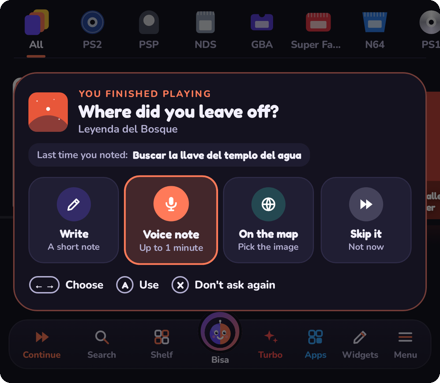

# Díptico

**A dual-screen Android frontend for retro handhelds.**
Top screen shows off your game. Bottom screen is where you pick it.

[**⬇ Download the beta**](https://github.com/Nikalbazu24/diptico-frontend/releases/latest) · [**🎮 Become a tester**](https://github.com/Nikalbazu24/diptico-frontend/issues/new?template=2-tester.yml) · [**🐞 Report a bug**](https://github.com/Nikalbazu24/diptico-frontend/issues/new?template=1-bug.yml) · [Español](README.es.md)

## 🧪 We're looking for beta testers

Díptico is in **open beta**. It was built on an AYN Thor, and now it needs more hands and more devices.

**Who we're looking for:**

- Anyone with an **AYN Thor**: it's the device Díptico was designed for.
- Owners of **other handhelds**: Odin 2, Retroid Pocket, Anbernic, AYANEO and others.
- People who play on a **phone, tablet or TV** with a controller.
- People who use **ES-DE, Daijishō, Cocoon or iiSU** today and can tell us what's missing.

**What testing means:**

1. Install the latest APK and use Díptico as your launcher for about a week.
2. Tell us what broke, what was confusing and what you loved.
3. That's it. No coding needed. Write in English or Spanish.

👉 [**Sign up as a tester**](https://github.com/Nikalbazu24/diptico-frontend/issues/new?template=2-tester.yml): it's a short form about your device.

## ✨ What makes it different

<table>
<tr>
<td width="50%"></td>
<td><b>It remembers where you left off.</b> When you quit a game, Díptico asks where you were. Type it, record a voice note or drop a pin on the game's map. Next time, it reminds you.</td>
</tr>
<tr>
<td></td>
<td><b>Built for two screens from day one.</b> Art, logo and playtime on top; shelf, folders or carousel below. Hold A on any game or app to choose which screen it opens on. One screen works too.</td>
</tr>
<tr>
<td></td>
<td><b>A home screen of widgets.</b> Clock, music, battery, playtime, collections, GIFs and shortcuts to your favorite games. Arrange them with the D-pad.</td>
</tr>
<tr>
<td></td>
<td><b>Themes, sounds and holidays.</b> Seasonal themes, your own colors, or a theme made by AI.</td>
</tr>
</table>

**Also inside:**

- 🕹️ **Fan games** (RPG Maker XP/VX/VX Ace, like Pokémon Essentials games) open straight away with [Essentia](https://github.com/Nikalbazu24/essentia).
- 🔔 **Notifications and quick settings, apart**: swipe down from the top left for notifications, from the top right for quick settings.
- ☁️ **Google Drive backup** of your settings, collections, playtime and notes, updated daily.
- 🤖 **Bisa**, a built-in helper you can talk to: what to play, how to beat a part, or change a setting for you. Works offline, or with your own Gemini or ChatGPT key.
- 🖼️ **Covers, art and logos** from libretro, SteamGridDB, ScreenScraper, IGDB, TheGamesDB and RAWG (you bring your own free accounts).
- 🏆 **RetroAchievements** in each game's page.
- 🎮 **Fully controller-driven**, with a big on-screen keyboard and voice typing.
- ⚡ **Turbo** button to free memory before launching heavy games.
- 🔄 **Updates from inside the app**, with a tour of what's new.
- 🌍 **Spanish, English, Portuguese, Chinese and Japanese.**

## 📥 Install

1. Open [**Releases**](https://github.com/Nikalbazu24/diptico-frontend/releases/latest) on your device.
2. Download the APK that fits:
   - **Consoles** (AYN Thor, Odin, Retroid…): `Diptico-v1.0-beta.N.apk`
   - **Phones**: `Diptico-v1.0-beta.N-movil.apk`. It skips the notification access that makes Google Play Protect block the full version.
3. Open it and let Android install it. The first launch walks you through picking your games folder and emulators.

New versions install over the old one, and you keep your games and settings. Díptico checks for updates on its own.

**Requirements:** Android 10 or newer.

## 🗂️ Your games

Díptico reads the same folder layout as **ES-DE**: one folder per system inside your games folder (`snes`, `psx`, `ps2`, `switch`, `n3ds`…). If you already use ES-DE, point Díptico at the same folder and at ES-DE's `downloaded_media`.

It launches more than 100 systems through their usual Android emulators: RetroArch cores, DuckStation, NetherSX2, PPSSPP, Dolphin, melonDS, Azahar, Eden, Cemu and more. The full table is in the [Spanish README](README.es.md#cómo-ordenar-tus-juegos).

> Díptico does **not** include or link to games or BIOS files. Use your own legally obtained copies.

## 🛠️ How it's built

Kotlin + Jetpack Compose. Every push to `main` builds the APKs with GitHub Actions and renders screenshots of every screen at the Thor's resolution, so changes can be reviewed visually before they ship.

## 🙏 Credits

- Launch rules and the system list come from [ES-DE](https://es-de.org) (MIT license).
- Covers from [libretro-thumbnails](https://github.com/libretro-thumbnails); system icons from [retroarch-assets](https://github.com/libretro/retroarch-assets).
- Pixel font for the block theme: Tiny5 (SIL Open Font License 1.1).
- Game history from Wikipedia.

Made in Chile 🇨🇱 by [@Nikalbazu24](https://github.com/Nikalbazu24).
