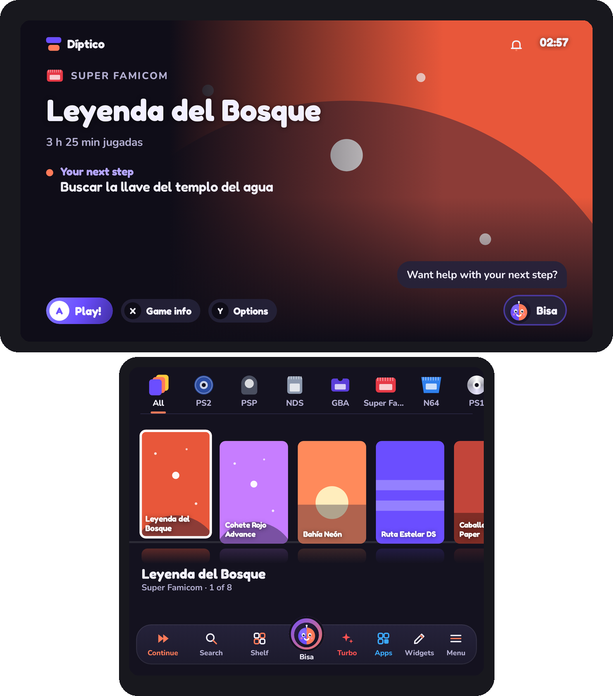
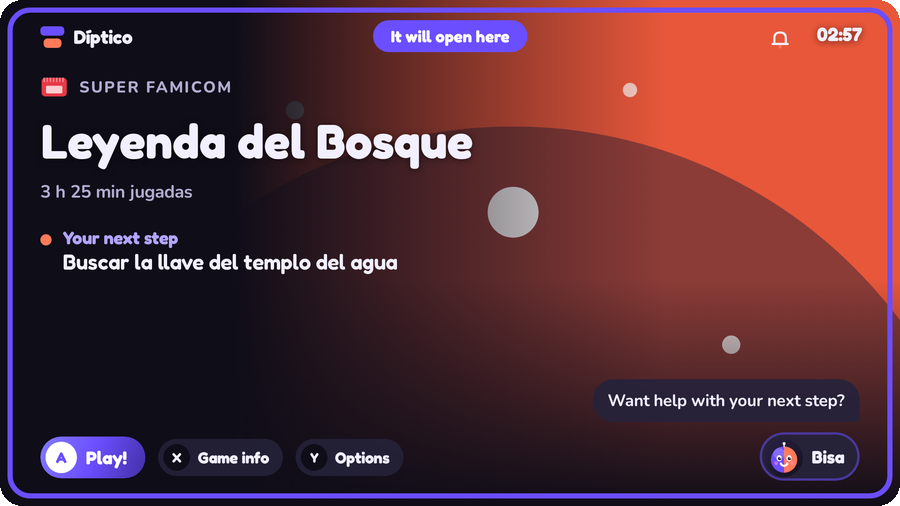
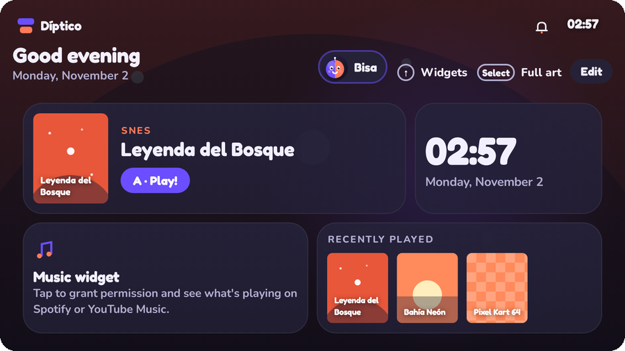
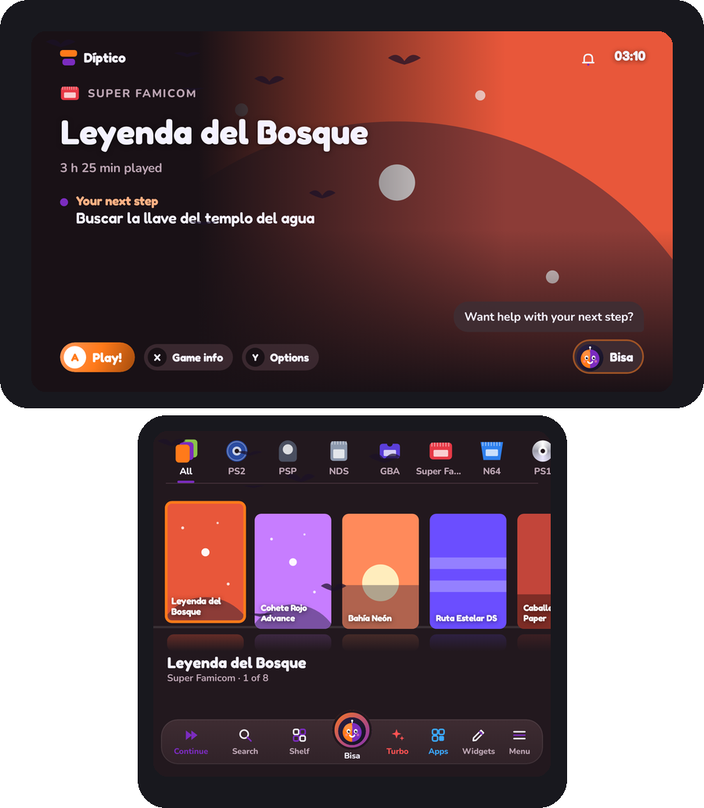

# Díptico

**An Android game launcher for one or two screens.**

On a dual-screen handheld, game art fills the top screen and you browse the library below. On one screen, the library, home and settings share the same interface.

[Download the beta](https://github.com/nikalbazu24/Diptico-frontend/releases) · [Join the beta](https://github.com/nikalbazu24/Diptico-frontend/issues/new?template=2-tester.yml) · [Report a bug](https://github.com/nikalbazu24/Diptico-frontend/issues/new?template=1-bug.yml) · [Español](README.es.md)

See example screenshots

## Install and update

1. Open [Releases](https://github.com/nikalbazu24/Diptico-frontend/releases) on your **ARM64 device running Android 10 or newer**.
2. In the public `v1.1-beta.N` release, download `Diptico-v1.1-beta.N.apk` for handhelds or `Diptico-v1.1-beta.N-movil.apk` for phones. The phone variant omits notification access and the widgets that rely on it.
3. Open the APK. The setup tour helps you choose a screen mode, add your folders and connect emulators. You can set Díptico as your Android home app.
4. Updates with the same signing certificate install over your existing copy. Díptico checks for the matching variant and offers it in **Menu › About**. On launch, the tour catches you up on releases you skipped. If you're upgrading from a beta with a different signature, see the [migration guide in Spanish](docs/distribucion.md).

You'll need your own game and BIOS files and the corresponding emulators.

## Screens and controls

- **Two screens.** Show game art, logos, details or previews above, with the library or widgets below. Hold Select to swap screens. Choose and remember where each game or app opens, and pin a game page to the other screen.
- **One screen.** The library, folders, widgets, touch toolbar, keyboard, galleries and theme store work on the main display. Preview and apply gallery choices on the same screen. Settings also have previews.
- **Device and TV layouts.** Profiles cover AYN Thor, Odin, Retroid, Anbernic, AYANEO, phones, tablets and TVs. Adjust display scale and text size. Docked mode adapts margins, scale, sound and effects for a TV.
- **Navigation.** Controller and touch support, configurable sticks and extra buttons, on-screen keyboard with voice input and searchable settings. Pin and arrange Android apps in the drawer, choose their screen or uninstall them through Android.
- **Control center.** Quick access to connectivity, brightness, volume, Turbo and Do Not Disturb. In the full variant, notifications open separately and playback from other apps can be controlled from Díptico.

## Game library

- **Game folders.** Add folders from internal storage or SD using ES-DE system names, or assign a system yourself. Connect ES-DE's `downloaded_media` and preview title and favorite changes before importing a `gamelist.xml`.
- **Emulation and native games.** Use ES-DE launch rules, select an emulator or RetroArch core per system or game, and include installed Android games, ports and PC shortcuts. Add Steam titles to open with a supported client installed on your device. RPG Maker XP/VX/VX Ace fan games open with [Essentia](https://github.com/Nikalbazu24/essentia) from `rpgmaker`, `fangames` or an `.essentia` shortcut.
- **System views.** Top tabs, sidebar, wheel, system carousel, folders and records. Reorder systems and customize their names, colors, artwork, logos, music and case shapes.
- **Folder icons.** Pinch the grid to resize it and choose horizontal or vertical scrolling. Open the games in a window over the blurred grid or in full screen. Press **X** or hold an icon to find system or game artwork from available providers, or pick a local file. In Folder, Mosaic and Showcase layouts, **Selected Game** cycles through games in the focused folder.
- **Game views.** Shelf, grid, list, 3D carousel, fan and spines. Set the case size and shape and choose cover, screenshot or logo. Group game variants and select a disc from supported playlists.
- **Organization.** Accent-insensitive search, favorites, recently played, most played, unplayed, manual ordering, filters and custom collections. Tap **Exit Hidden** or press **B** to restore your previous view after searching hidden games.
- **Artwork and game pages.** Download or select covers, hero art and logos. Crop images, edit titles, assign music, and see game history, guides, notes and RetroAchievements. For files managed by Díptico, the uninstall prompt lists the items it will remove before you confirm.

For example folder names and emulator options, see the [system table in Spanish](README.es.md#carpetas-y-emuladores) or the [full system catalog](app/src/main/assets/sistemas.json).

### Artwork sources

Díptico reads local images with the same name as the game, either alongside it or in a folder such as `covers`. It can also read ES-DE's `covers`, `fanart` or `screenshots`. Use **Menu › Covers** to download missing artwork or choose individual images. Artwork types vary by provider and system.

| Source | Access |
|---|---|
| libretro-thumbnails, RetroArch packs and Wikipedia | No key |
| SteamGridDB | Account API key |
| ScreenScraper | Username and password, plus developer ID and password |
| IGDB | Twitch Client ID and Client Secret |
| TheGamesDB and RAWG | Provider API key |

## Home and personalization

- **Widgets.** Pinch to resize the grid and move or resize widgets with touch or a controller. The studio lets you set size, background, shape, design, colors and content. Widgets include the selected game, clock, battery, music, notifications, favorites, recent games, statistics, achievements, holidays, timer, stopwatch, search, Bisa, play queue, suggestions for short sessions, collections, shortcuts, images, GIFs and short videos.
- **Built-in theme store.** Find, preview and install **30 included themes** offline under **Menu › Themes › Theme Store**. On dual-screen devices, the store opens on top. Designs inspired by Mario, Pokémon, Zelda, Metroid, Kirby and Sonic have their own palettes, shapes, backgrounds, music, sounds and decorations.
- **World and Chilean calendars.** Automatic themes mark occasions such as Lunar New Year, Halloween, Day of the Dead, Chilean Independence celebrations, Christmas, Navy Day and La Tirana. Under **Menu › Decorations**, expand a theme to choose its decoration and intensity where applicable. Examples include mistletoe or bells for Christmas and chupallas or kites for Chile.
- **Your style.** Light, dark and OLED modes, custom colors, built-in or local music, sound packs and button shapes. **Mix My Theme** combines colors, backgrounds, typography, shapes, decorations, sound effects and music from installed themes. **Game Universe** uses colors from your local game art. Collections can have their own colors, backgrounds, logos, music and layout.
- **Shareable themes and profiles.** Import themes from JSON or a link, create a theme with AI, and import or export layout profiles. Contributors can create themes in the [web studio](https://diptico-temas.nickalbazu.chatgpt.site). The [community guide in Spanish](docs/temas-comunidad.md) documents the format and how to test a theme in Díptico.

## During and after play

- **Play log and statistics.** Track sessions and playtime, leave a text note, voice note or map pin for your next session, and pick up where you left off. Set break reminders and build a queue for future sessions.
- **In-game companion.** The free screen can show time, battery, session length, a game logo, controls and Bisa. Magnifier can enlarge a region of the other display. The optional resume clip captures up to six seconds without audio. Both need Android screen-capture permission, and Magnifier takes priority. [Resume guide in Spanish](docs/navegacion-retoma.md)
- **RetroAchievements and saves.** Connect your account and Web API Key to see per-game achievements and statistics. Keep up to three manual copies of a RetroArch `.srm` save and export them for recovery.
- **Bisa.** Get library recommendations, tiered hints, shortcuts and optional web search. Type or speak, use the optional offline model, or connect your own Gemini or OpenAI key. The in-game bubble requires Android's overlay permission.
- **Performance and idle.** Smoothness settings, including a power-saving mode, Turbo, dimming during play and a screensaver featuring your library. Díptico can greet you on wake and offer a shortcut to your last game.

## Settings, backups and help

- **Backups.** In **Menu › About**, back up or restore settings, collections, playtime and text or voice notes using a local file or Google Drive. Díptico can refresh the backup daily after you choose a destination. Set up credentials and folder permissions again on each device.
- **Languages.** Spanish, English, Portuguese, Simplified Chinese and Japanese.
- **Open beta.** Review the contents of a diagnostic before sending it, or file a bug on GitHub. Include your device, app version, screen mode and steps to reproduce. [Bug report form](https://github.com/nikalbazu24/Diptico-frontend/issues/new?template=1-bug.yml)

### Default shortcuts

| Control | Action |
|---|---|
| D-pad or stick, L1 / R1 | Browse games and switch systems |
| L2 / R2 | Jump by letter |
| A, B | Enter or play, go back or close |
| Hold A | Choose where a game or app opens |
| X, Y | Game page and game options |
| L3, R3 | Search and choose a view |
| Select, hold Select | Switch between library and widgets, swap screens |
| Start, hold Start | Menu and control center |
| Start + R3 | App drawer |

## Development and credits

Díptico uses **Kotlin and Jetpack Compose**. GitHub Actions runs tests, builds the full and phone variants and renders UI screenshots. App changes on `main` publish the signed beta. See the [distribution guide](docs/distribucion.md), [beta notes](docs/novedades-beta.md) and [release history](https://github.com/nikalbazu24/Diptico-frontend/releases).

- Launch rules and base system catalog from [ES-DE](https://es-de.org) (MIT).
- Covers from [libretro-thumbnails](https://github.com/libretro-thumbnails) and icons from [retroarch-assets](https://github.com/libretro/retroarch-assets).
- Tiny5, the pixel font for the block theme, under SIL Open Font License 1.1.
- Game history from Wikipedia.

Made in Chile by [@Nikalbazu24](https://github.com/Nikalbazu24).
