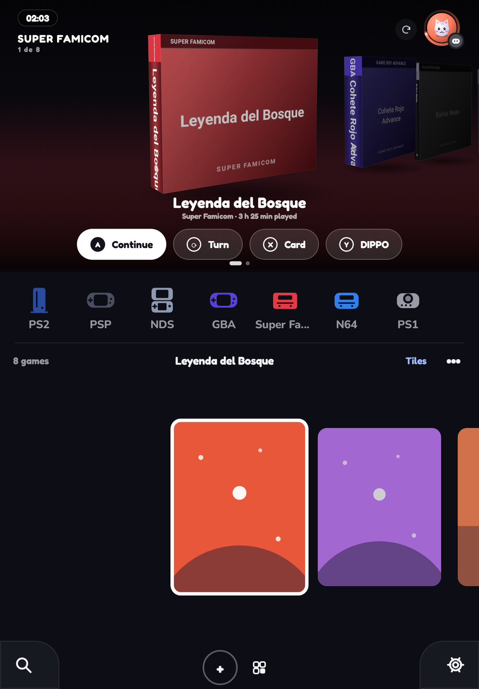
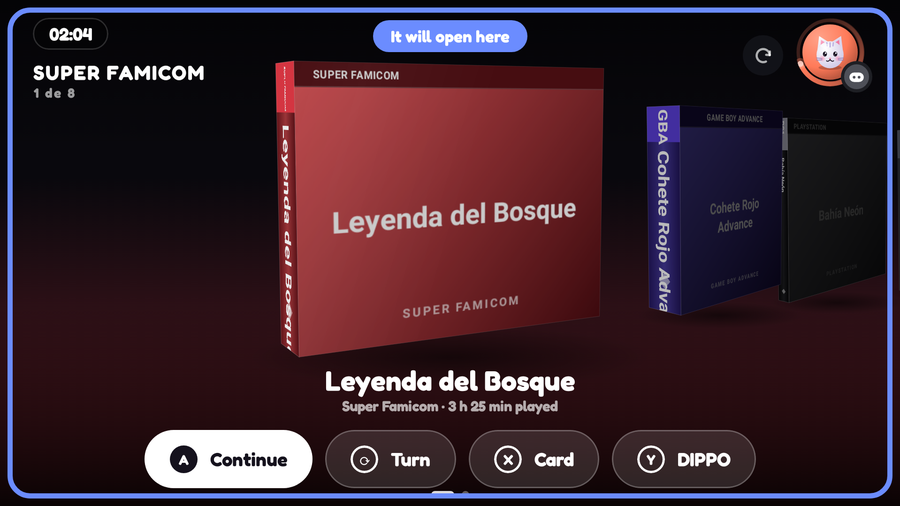
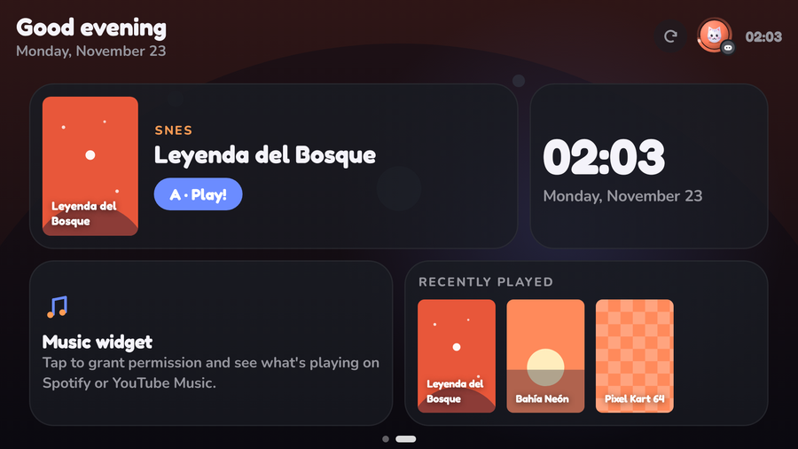
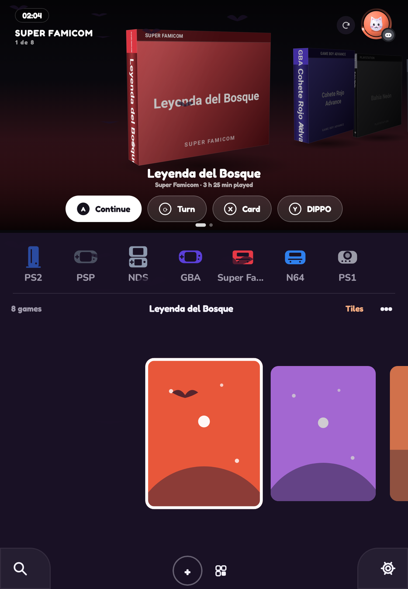
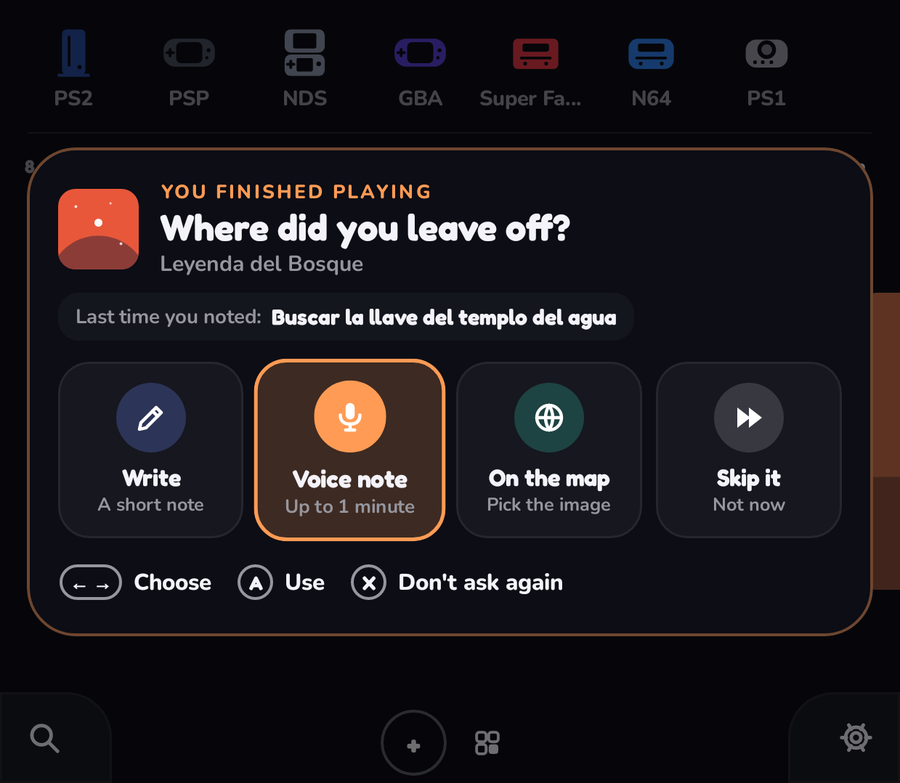

# Díptico

**An Android game launcher for one or two screens.**

On a dual-screen handheld, game art fills the top screen and you browse the library below. On one screen, the library, home and settings share the same interface.

[Download the beta](https://github.com/nikalbazu24/Diptico-frontend/releases) · [Join the beta](https://github.com/nikalbazu24/Diptico-frontend/issues/new?template=2-tester.yml) · [Report a bug](https://github.com/nikalbazu24/Diptico-frontend/issues/new?template=1-bug.yml)

See example screenshots

## Version 2.0.0 status

The **2.0.0** series introduces the Living Collection interface, flexible widgets and a complete onboarding tour with DIPPO. Candidate `v2.0.0-rc.736` has passed automated builds and tests in GitHub Actions.

Before the official beta is published, real-device validation should cover:

- controller navigation on one and two screens;
- updating over an earlier beta installation;
- emulator and game launching in both layouts;
- performance with large libraries;
- artwork, backgrounds and widget rendering.

## Install and update

1. Open [Releases](https://github.com/nikalbazu24/Diptico-frontend/releases) on an ARM64 device running Android 10 or newer.
2. Download `Diptico-v2.0.0-rc.N.apk` for handhelds or `Diptico-v2.0.0-rc.N-movil.apk` for phones.
3. Back up your settings and saves before changing versions.
4. Open the APK and follow setup to choose a screen mode, add folders and connect emulators.
5. You may set Díptico as your Android home app.

The phone variant omits some console-only features, such as cross-screen notifications and widgets that depend on them.

## What's new in 2.0.0

- **Living Collection** with animated showcases, consoles, 3D cases and collection-specific backgrounds.
- **Your Space** with configurable widget pages and touch/controller editing.
- **Transparent floating dock** with visible content behind it and unchanged button behavior.
- **Interactive DIPPO tour** with real challenges and focus areas calculated from visible interface elements.
- **One-screen and dual-screen layouts** with consistent navigation and transition behavior.
- **Per-game emulator selection** from the customize page, alongside global system settings.
- **Project Lemon recognition** for compatible Nintendo Switch 1 games.
- **Shareable visual profiles and themes**.
- **Smoother transitions** between library, folders, widgets and panels.

## Screens and controls

- **Two screens.** Game art appears above while the library, widgets or dock are below. Hold Select to swap screens.
- **One screen.** Library, home, widgets, keyboard and settings share the main display.
- **Device and TV layouts.** Display scale and type settings for AYN Thor, Odin, Retroid, Anbernic, AYANEO, phones, tablets and TVs.
- **Controller and touch.** D-pad, sticks, configurable extra buttons and touch navigation.
- **Control center.** Connectivity, brightness, volume, Turbo and Do Not Disturb; the full variant also includes notification and music controls.

## Game library

- Local covers and ES-DE-compatible metadata and artwork.
- System folder names with automatic recognition.
- Emulator or RetroArch core selection per system or game.
- Android games, ports, PC shortcuts and compatible launch rules.
- Shelf, grid, list, 3D carousel, fan and spine views.
- Accent-insensitive search, favorites, recently played, most played, filters and collections.
- Covers, hero art, logos, game pages, notes, music and play history.
- RetroAchievements and tools for grouping game variants.

### Folder and emulator examples

| Folder | System | Common emulators |
|---|---|---|
| `snes`, `gba`, `n64` | Super Nintendo, Game Boy Advance, Nintendo 64 | Snes9x EX+, Pizza Boy GBA, Mupen64Plus FZ, RetroArch |
| `psx`, `ps2`, `psp` | PlayStation, PlayStation 2, PSP | DuckStation, NetherSX2, PPSSPP, RetroArch |
| `gc`, `wiiu` | GameCube, Wii U | Dolphin, Cemu |
| `nds`, `n3ds` | Nintendo DS, Nintendo 3DS | melonDS, DraStic, Azahar, Citra |
| `switch`, `psvita` | Nintendo Switch, PS Vita | Eden, Kenji-NX, Skyline, Vita3K |
| `rpgmaker` | RPG Maker | Essentia |

Choose an emulator in **Menu › Emulators** for a system. In **Game page › Customize**, you can choose a specific option for that game.

## Personalization

- Reorganizable widget pages with configurable sizes and shapes.
- 30 included themes that work offline.
- Light, dark and OLED modes.
- Custom colors, music, effects, backgrounds and button shapes.
- Visual profiles that can be exported and imported.
- Shared themes through files or links.
- World and Chilean calendar themes for special dates.

## During and after play

- Play log with session time, notes and next activity.
- Last-session recovery and optional continuation tools.
- DIPPO/Bisa companion on the free screen.
- Magnifier for an area of the other screen.
- RetroAchievements and multiple manual saves for supported formats.
- Game recommendations, hints and optional AI tools.
- Smoothness modes, battery saving and a library screensaver.

## Settings, backups and help

- Back up or restore settings, profiles, collections and notes using local storage or Google Drive.
- Languages: Spanish, English, Portuguese, Simplified Chinese and Japanese.
- Optional diagnostics that can be reviewed before sending.
- A tour that highlights what changed in new releases.

### Default shortcuts

| Control | Action |
|---|---|
| D-pad or stick, L1 / R1 | Browse games and switch systems |
| L2 / R2 | Jump by letter |
| A, B | Enter/play, go back or close |
| Hold A | Choose where a game or app opens |
| X, Y | Game page and game options |
| L3, R3 | Search and choose a view |
| Select | Switch between library and widgets |
| Hold Select | Swap screens |
| Start | Menu and control center |
| Hold Start | Control center |
| Start + R3 | App drawer |

## Development

Díptico uses **Kotlin and Jetpack Compose**. GitHub Actions runs tests, builds the full and phone variants and renders interface screenshots.

- System launch rules and base catalog from [ES-DE](https://es-de.org) (MIT).
- Covers from [libretro-thumbnails](https://github.com/libretro-thumbnails).
- Icons from [retroarch-assets](https://github.com/retroarch/retroarch-assets).
- Tiny5, Kalam, Press Start 2P and Josefin Sans under open font licenses.
- Game history from Wikipedia.

Made in Chile by [@Nikalbazu24](https://github.com/Nikalbazu24).
